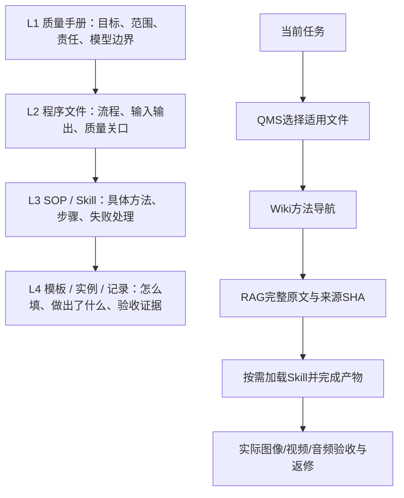

# AI Video QMS · AI视频全链路质量体系

用四级受控文件管理 AI 视频、短剧、动漫与图像资产生产，让大模型按当前任务找到适用的规范、Skill、方法和原文依据。

**QMS 选规范 → Wiki 找方法 → RAG 读原文 → Skill 写出产物 → 依据真实结果验收。**

公开版包含 **143 份受控文件、8 个模型入口配置、4 个可安装 Skill、19 类图像用途与 10 种版式、6 份原创方法示例**。面向 Codex、Claude 等支持 Markdown Skills 和本地工具的助手；Kimi、GLM、DeepSeek 等可通过支持本地工具调用的宿主读取同一套文档。仓库验证工具与文档可用性，不据此声称每个模型都已实测。

[English overview](README.en.md) · [快速上手](docs/QUICKSTART.md) · [四级总目录](standards/INDEX.md) · [Wiki](wiki/overview.md) · [来源与许可](THIRD_PARTY_NOTICES.md)

## 四级分类



空白模板、外来案例和已发生的验收记录分别管理。用途、版式、专业、风格、模型/版本/平台/模式、来源权威、审批与验证状态是独立维度，不能仅靠文件名 `SKILL.md` 决定级别。

四级结构借鉴质量管理的过程、文件控制和证据思路；本项目没有 ISO 9001 认证，也不把四级结构当成认证的强制规定。

## 覆盖全流程与专业

需求与边界 → 剧本与系列设定 → 角色/服装/场景/道具/声音资产 → 故事板与分镜 → 镜头设计 → 精确模型适配 → 生成交接 → 剪辑与视听审核 → 最小修复与回归 → 交付归档。

| 专业 | 需要明确的生产事实 |
|---|---|
| 编剧、导演 | 因果节拍、目标与刺激、信息揭示、对白与潜台词 |
| 表演 | 面部与微表情、目光对象、呼吸、肢体、听者反应、语气；用可见/可听行为呈现情绪 |
| 调度、美术、动作 | 站位与轴线、道具归属/交接、服装与材质、空间拓扑、接触/受力/反应 |
| 摄影、灯光、特效 | 景别与机位、焦点/透视/运镜、光源与颜色、特效来源/生命周期/遮挡/交互 |
| 声音、剪辑、连续性 | 声线/重音/停顿、拟音/音乐、节奏与转场、镜头首尾状态和跨镜一致性 |

图像用途包括人物、三视图、表情、动作、服装、道具、载具、生物、场景、空间平面、氛围、材质、单镜分镜、故事板、首尾关键帧、风格板、特效、图文标识、宣传图；版式另选单图、三视图板、四/九/十六宫格、条带、联系表、爆炸图、剖面、平面图。目录可按程序扩展。

## 5分钟运行

安装 Python 3.10+ 和 Node.js 20+，无需安装 Python 或 npm 包。

```bash
git clone https://github.com/ouyang-2019/ai-video-qms.git
cd ai-video-qms
python -X utf8 tools/qms.py doctor
python -X utf8 tools/qms.py seed-demo
python -X utf8 tools/qms.py wiki --task micro-performance
python -X utf8 tools/qms.py search "停顿 目光 道具"
python -X utf8 tools/qms.py context --task micro-performance --query "杯子 停顿"
python -X utf8 tools/qms.py shot-check --plan examples/cup-pause/shot-plan.json
python -X utf8 tools/qms.py shot-bundle --plan examples/cup-pause/shot-plan.json --out data/demo-shot-bundle.md
```

`context` 的搜索结果只是候选；阅读 `get SRC-...` 后，用 `--evidence-ids` 指定要采用的完整正文。所有包包含文档 ID、版本、SHA 和选择依据；预算超限会报错，不静默截断。运行样例只完成设计与上下文准备，不生成媒体。

## 安装 Skill

保持仓库在本机，复制**完整** Skill 文件夹。安装器会为副本写入仓库定位文件，已有同名 Skill 时拒绝覆盖。

```bash
# Codex / Agent Skills：在实际视频项目中选择安装目录
python -X utf8 tools/install_skills.py --target ../my-video-project/.agents/skills
# Claude Code 项目技能
python -X utf8 tools/install_skills.py --target ../my-video-project/.claude/skills
```

| Skill | 作用 |
|---|---|
| `ai-video-qms` | 选择规范、模型入口、分类、模板与验收边界 |
| `ai-video-fullchain` | 指导模型用 QMS + Wiki + RAG 为各阶段找方法和证据 |
| `shortdrama-production-qa` | 短剧制作、一致性、审片、返修复验、恢复与归档 |
| `shortdrama-micro-performance` | 将情绪目标转成目光、呼吸、脸部与肢体节拍 |

向助手说：`使用 $ai-video-fullchain，为我的镜头设计微表演。先取适用QMS和Wiki，再读原文；保留人物、道具和首尾状态，输出可观察验收点。`

仓库移动后重新设置 `AI_VIDEO_QMS_HOME`，或修改安装副本的 `.runtime.json`。具体兼容与安装见[上手说明](docs/QUICKSTART.md)。

## 模型入口与扩展

本版导出已发布的 **2.0.5** 规范，形成独立的 **2.0.5-public.1**；公开工具与 Skill 版本为 **0.1.0**。8 个入口覆盖 H3、Seedance 2.0/2.5、Wan 2.2/2.6/3.0、GPT Image、Seedream。这些是带采集日期的文档快照，实时平台能力、账户限制和参数仍需依据目标平台当前官方资料核实。

```bash
python -X utf8 tools/qms.py profiles
python -X utf8 tools/qms.py bundle --stage video --model h3 --version h3 --platform prompt-only --mode T2VA --facets performance.eyes,props.state,camera.motion
python -X utf8 tools/qms.py image-route --purpose storyboard_sequence --layout grid_3x3 --semantics temporal_sequence
```

新的模型以精确元组扩展 registry 和独立 SOP，不能靠相似名称切换参数。图像入口不能用于视频阶段。H3 的 `prompt-only` 只表示提示词准备，不能据此推断 API 传输字段。

## 本地来源与验证边界

RAG 是透明的本地全文检索（中文字符与英文词项评分），无需远程向量服务；Wiki 是可版本化的知识导航页，由 LLM 按证据编写并经复核后纳入。当前未提供向量数据库或自动 Wiki 生成服务。

导入从 `pending` 开始，批准绑定全文 SHA。`local` 仅本地模型可取，`no_ai` 全部拒绝；正文变化需要重新判读。导入、分类、方法审查、人工审批、平台执行和视听验收分开记录。`data/`、运行配置和媒体默认不入 Git。

公开包没有分发私人知识库、制作素材、实际项目记录或第三方 Skill/提示词全文。外部来源保留链接、版本与已知证据缺口；额外资料按[来源接入程序](docs/SOURCE_INTAKE.md)导入。原本的本地冻结版本保持独立。

维护频率由使用者决定；仓库本身不会启动后台任务。一次发布通过工具测试，不能证明全部提示词已语义审完，也不能证明生成视频达到“最高质量”。

## 验证与贡献

```bash
node --test tests/qms.test.js
python -B -X utf8 -m unittest discover -s tests -p "test_*.py"
python -B -X utf8 tools/check_public.py
```

[贡献流程](CONTRIBUTING.md) · [版本记录](CHANGELOG.md) · [安全说明](SECURITY.md) · [MIT License](LICENSE)
