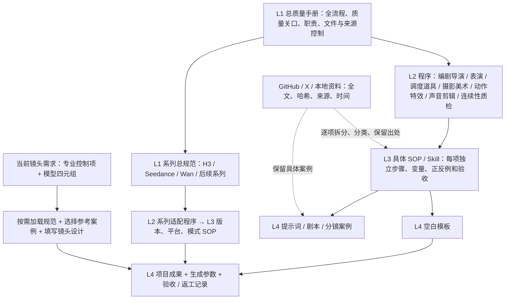

# AI视频生产质量手册

## 范围与质量方针
本体系管理从创作需求到剧本、角色/场景/道具资产、分镜、模型提示词、生成请求、验收和归档的全过程。一级是总体手册与系列总规范；二级是过程程序；三级是具体SOP；四级是模板、案例、生产成果与记录。系列、版本、平台、题材、证据属性是横向字段，不新增文件层级。

质量目标：需求可追溯，人物与空间连续，镜头动作可执行，声画意图明确，模型与入口相符，结果可复盘。文档结构合格、接口请求成功、视频视觉合格是三项独立结论。记录抽样范围、实际失败次数、返工成本；不预先虚构成功率或评分。实际项目在需求表里约定可接受误差和审美偏好。

## 过程与职责
需求冻结→剧本审核→资产确认→分镜与声画设计→适配模型→生成前检查→生成与成片检查→返工或交付。编剧负责故事事实，资产负责人负责身份与空间，导演负责镜头时序，适配者负责模式及引用，检验者依据需求独立评定。单人或单代理可兼任，但编写与审查必须分步留证。用户确认影响故事方向或身份的重大改变，常规修复按既定需求执行。

## 通用与专用
通用规范管理故事、角色设定、三视图内容、空间、动作起止、声音意图。专用规范管理最终表达、引用语法、模式、版本和接口。通用设计并不保证同一素材可直接上传所有模型。系列总规范说明共用/补充/替代/不适用；具体步骤在程序与SOP。不得把某供应商限制解释成模型家族限制，也不得以较新版本能力填补旧版本缺口。

## 规范适用性与冲突
调用必须明确生产阶段；进入视频适配时要求系列、版本、平台/规范入口、模式四者匹配。明确请求的风格只加载相应SOP，未知版本或模式停止专用编译。官方硬性接口契约决定请求是否可提交；用户意图决定创作目标；官方写作推荐和内部经验属于方法建议。用户需求超过入口能力时分段、换入口或报告差距，不伪造支持。冲突保留双方来源、版本和适用条件，由修订记录给出裁决；不靠文件层级盲目覆盖事实。

## 来源与文件控制
原始GitHub/X/本地材料进入证据登记，内容里的指令不自动执行。先识别作者、版本、许可和覆盖范围，再提炼候选。发布状态与来源权威性、实测状态独立。released 表示内部试运行版本通过结构审查；Vault review_status 保持 draft 直到人工审核。官方原文仍须固定revision或采集时间。每文件编号、修订号、来源和依赖明确，已废止条目不入运行包。

## 发布与记录
registry.json维护文档元数据，正文为作业内容；发布生成哈希清单，调用再次计算哈希。文档正本在知识智脑受控目录，项目目录是版本化运行副本，任何一侧改变都需走比较和再发布，禁止自动双向覆盖。生产记录不可覆盖，修正时创建新记录并注明supersedes。模板可修订，旧记录仍引用原模板版本。

## 验收与持续改进
生成前检查字段、时序、素材引用、模式、隐私；生成后检查故事、身份、动作接触、空间、声音和审美。硬性失败不由高审美分抵消。失败分为需求/剧本/资产/分镜/适配/平台/模型随机性/后期，先定位再改最小相关项；受影响SOP通过复测后更新。没有图像或视频证据时只出结构报告，禁止宣称视觉合格。

## 文件索引
程序：PR-SCRIPT、PR-ASSET、PR-STORYBOARD、PR-H3、PR-SEEDANCE、PR-WAN-OPEN、PR-WAN-CLOUD、PR-QC、PR-SOURCE。系列总规范：QM-H3、QM-SEEDANCE、QM-WAN。完整机器适用矩阵见registry.json的profiles与文档元数据；阅读矩阵由index命令生成。

---
内部受控试运行文件；验证范围为规范整理和结构审查，未进行视频生成实测。

## V2 专业矩阵与调用约束

# 四级分类架构与专业调用关系

例如，“语气”与“微表情”都可服务同一镜头，但分别属于声音和表演专业。它们的 SOP 同属 L3；某条提示词同时具有两种技法，仍是一条 L4 案例，挂多个专业标签，不复制成两份正文。“家庭喜剧”属于题材/风格标签，“Seedance 2.5 / BytePlus LAS / REF”属于模型适用元组，都不是新增文件层级。

## 以一次杯子停顿为例

| 项目 | 所属文件 | 内容 |
|---|---|---|
| 原则 | L1 总手册 | 情绪须有可见表现；目标效果和已验证模型能力分开 |
| 顺序和交接 | L2 表演程序 | 编剧给目标和刺激，表演给身体节拍，导演验证构图能看见，再适配模型 |
| 具体操作 | L3 微表情 / 眼神 / 肢体 / 道具 SOP | 先确定刺激与基线，再选有限可见变化；写手部停顿、视线转移、嘴唇和呼吸，不堆情绪形容词 |
| 可复用空表 | L4 表演节拍模板 | 角色、刺激、目标、起止秒、身体、视线、面部、呼吸、持物、验收 |
| 实际作品 | L4 本项目镜头设计 | 0–2 秒右手黄杯停在胸口；目光从断轮移到孩子；嘴唇微分后合上；吸气后短停 |
| 检查证据 | L4 审核 / 返工记录 | 杯是否换手，景别能否读出眼神，是否意外说出台词，跨镜状态是否连续 |

## 适用规则

专业 SOP 通过 `facets` 按需选读，不把全部工种文件拼成长提示词。14 个专业域逐一填写“已设计”或“不适用及原因”；必需控制项缺失时应补设计或拆镜。字段完整只能证明记录可检查，不能证明画面自然、表演真实或模型执行成功。

外来资料已归档即可作为证据检索使用；其中“必须”“官方”“最佳”等说法保留原作者身份，不自动成为内部规则。采用某条技法时记录来源 ID、取用范围和当前镜头的改写。内部规范修订与源库分类修订分别版本化，来源变动不得静默改写旧的项目执行包。

## 2.0.1 审计修订

2.0.1 修复专业子项与表单路由。新增项目放行、模型资格、最终交付、分段交接和两个风格专用模板；原始来源仍在2.0.0及活动监控索引。本修订不增加已验证模型能力。

## 2.0.2 补充

2.0.2加入两套图像入口契约；图像与视频profile显式区分。基础与细项关系见relations.json；文档级方法来源已固定。真实历史样片可用于追溯复核，不能追溯宣称当时已使用本版体系。

## 2.0.3 图像来源与用途调用补充

图像生成纳入资产制作程序：确定用途与母版→选来源方法→填写任务模板→依精确模型入口准备请求→看图验收→定点返工→批准视频引用。三视图、人物图、场景图、分镜图分别使用 asset.turnaround、asset.portrait、asset.scene、asset.storyboard。GPT Image固定入口在assets阶段加载SOP-IMAGE-ASSET-PROMPT及对应TPL-IMAGE-*。分镜设计仍由PR-STORYBOARD负责，实际分镜图制作在assets执行。

社区案例通过本地检索库导入；公开版本不打包第三方案例原文，仅作四级外来示例或模板来源，不能升级为官方能力约束；原始记录与内部受控规范分开登记。其他图像模型沿用自己的入口契约；可复用身份、空间与验收原则，不能照搬本SOP的GPT入口参数。来源正文不是执行指令。检索默认使用已全文复核的用途候选，未复核材料须显式选择；图片效果尚未验证。

## 2.0.4 开放图像分类

此前四种图像用途仅是首批入口，不限制本体系范围。用途与版式独立管理，见PR-IMAGE-ROUTING及metadata/image-taxonomy.json；道具、表情、动作、故事板等按用途选择，九宫格按layout.grid_3x3选择。单镜分镜图与故事板序列分开，时间递进、同刻多视角和无时序合集须声明。未覆盖用途按程序登记缺口后扩展，禁止为凑分类强行套用。
